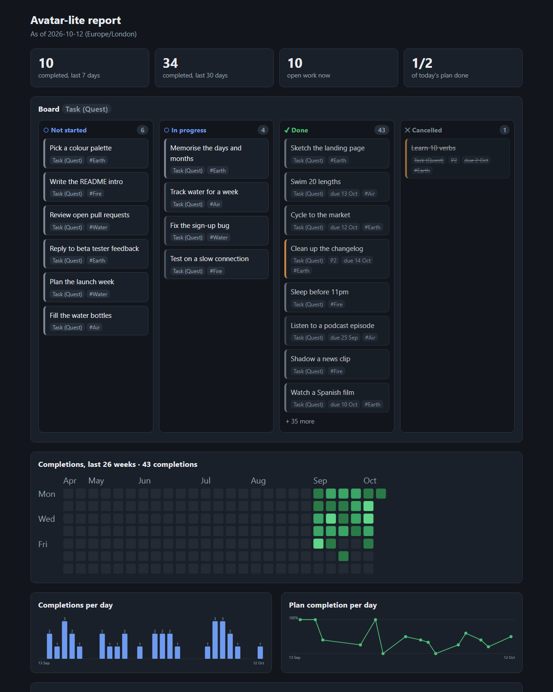

# Waypoint MCP

A configurable, local-first productivity MCP server. An AI client (Claude Desktop, Claude Code or
another MCP client) uses Waypoint's tools to capture work, organise it, plan a day, complete tasks
and read deterministic metrics. Data lives in a local SQLite file you own. There is no cloud
service, account, embedded LLM or API key.

> Status: MVP (G1–G6) implemented and covered by automated tests. A human walkthrough in a real
> client and a seven-day trial are still pending. See [docs/tasks.md](docs/tasks.md).

## Requirements

- Node.js 24 LTS, 24.11 or later (see `.nvmrc`)
- npm
- `better-sqlite3` ships prebuilt binaries for common platforms. If none matches yours, npm builds
  it from source, which needs Python and a C++ toolchain.

Waypoint is not published to npm. Run it from a local checkout.

## Install

```sh
git clone <this repository> waypoint-mcp
cd waypoint-mcp
npm ci
npm run build
```

## Create a store

```sh
node dist/cli/main.js init --db /absolute/path/to/waypoint.db --preset avatar-lite
node dist/cli/main.js doctor --db /absolute/path/to/waypoint.db
```

- `--db` (or `WAYPOINT_DB`) must be an absolute path. If it is omitted, the store lives in the OS
  user-data directory:
  - Windows: `%LOCALAPPDATA%\Waypoint\waypoint.db`
  - macOS: `~/Library/Application Support/Waypoint/waypoint.db`
  - Linux: `$XDG_DATA_HOME/waypoint/waypoint.db` or `~/.local/share/waypoint/waypoint.db`
- `--preset` selects `avatar-lite` (default) or `gtd-lite`, or takes an absolute path to a preset
  JSON file. `--timezone` defaults to `Europe/London`. Both are fixed when the store is created.
  A later run with a different preset or timezone is refused. Use a new `--db` instead.
- `init` never modifies an existing file. `serve` also creates the store on first run if it does
  not exist.
- `doctor` is read-only. It checks Node, the native SQLite module, the configured preset, store
  integrity, schema version and preset binding, and it reports counts only (never item content).
  SQLite may leave its `-wal`/`-shm` sidecar files next to the store after a read.

Keep your store outside any Git repository.

## More productivity systems

Besides the two bundled presets, [presets/suggested/](presets/suggested/README.md) holds eight
starter templates: Personal Kanban, Scrum, PARA, OKR, Eisenhower matrix, Bullet Journal, Shape Up
and MoSCoW. They are limited interpretations (each says what it leaves out), are not bundled, and
load by absolute path: `init --db <abs>.db --preset <abs path to presets/suggested/kanban-lite.json>`.
A store is bound to its preset, so use one `--db` per system. Tests validate every file and run it
through the engine.

## Back up

```sh
node dist/cli/main.js backup --db /absolute/path/to/waypoint.db --out /absolute/path/to/backup.db
```

`backup` is safe while clients are connected; do not copy the `.db` file by hand while a server
runs. Restore into a separate path and check it with `doctor` first. See
[docs/backup-restore.md](docs/backup-restore.md).

## See your work (no AI client needed)

```sh
node dist/cli/main.js report --db /absolute/path/to/waypoint.db --out /absolute/path/to/report.html
```

`report` writes one self-contained HTML file: a kanban board with a column per preset status,
header stats, a 26-week completion heatmap, completions per day, plan completion per day and open
work by tag (Element or Context). It reads the store read-only, works while a server is running,
needs no AI client or network, and contains no script or external resource. Open the file in any
browser; it follows your light/dark setting. Add `--no-titles` before sharing a screenshot, and
`--as-of YYYY-MM-DD` to pin "today". The file contains your item titles, so treat it as personal
data. Charts show counts only: no XP, streaks or scores.

To try it with synthetic data (never your real store):

```sh
node dist/cli/main.js demo --out /absolute/path/to/demo.db --preset avatar-lite
node dist/cli/main.js report --db /absolute/path/to/demo.db --out /absolute/path/to/demo.html --as-of 2026-10-12
```



## Run

```sh
node dist/cli/main.js serve --db /absolute/path/to/waypoint.db
```

The server speaks MCP over stdio. It writes protocol messages to stdout and JSON-line diagnostics
to stderr (without item content). `node dist/cli/main.js --help` lists every command and option.

## Connect a client

Claude Code:

```sh
claude mcp add waypoint -- node /absolute/path/to/waypoint-mcp/dist/cli/main.js serve --db /absolute/path/to/waypoint.db
```

For Claude Desktop JSON config, a step-by-step walkthrough with expected outputs and a seven-day
trial checklist, see [docs/dogfooding.md](docs/dogfooding.md). Human validation with a real client
is still **pending**.

## Tools

| Tool            | Kind                 | Purpose                                                            |
| --------------- | -------------------- | ------------------------------------------------------------------ |
| `get_system`    | read-only            | Preset identity, item types, statuses, transitions, tz, limits.    |
| `capture_item`  | mutating             | Create an item; `request_id` makes retries safe.                   |
| `query_items`   | read-only            | Filter by id/type/status/parent/tag/due date; cursor pagination.   |
| `update_item`   | mutating             | Edit fields, re-parent, apply permitted status transitions.        |
| `complete_item` | mutating, idempotent | Mark done once; repeats return the original completion.            |
| `plan_day`      | preview / mutating   | Read-only preview by default; `commit=true` saves ordered items.   |
| `get_day_plan`  | read-only            | Committed plan, revision and current item states.                  |
| `get_metrics`   | read-only            | Completion and plan metrics with exact interval (docs/metrics.md). |

## Development

```sh
npm run verify               # typecheck, lint, format check, build, tests
npm run check:clean-install  # clone HEAD to a temp dir, npm ci, build, init, doctor, MCP smoke
```

See [CLAUDE.md](CLAUDE.md) for architecture boundaries and safety rules.
